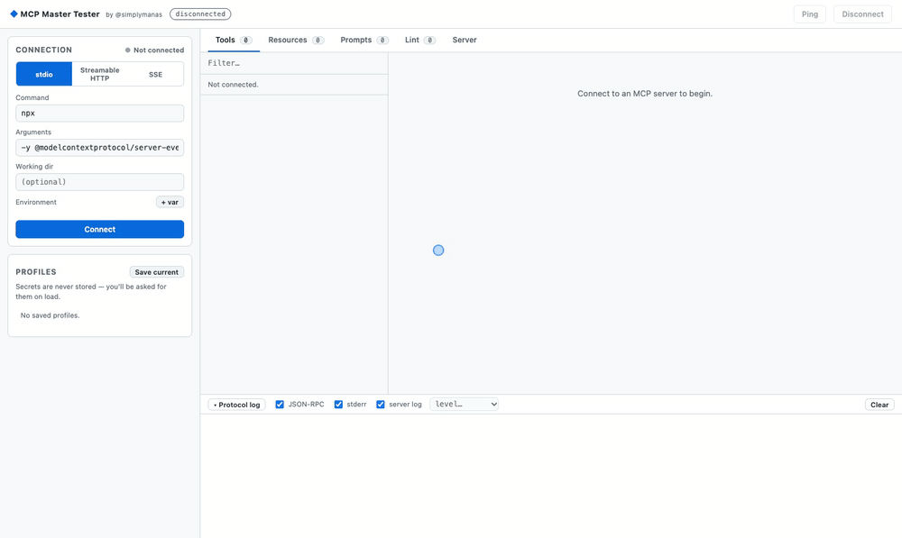
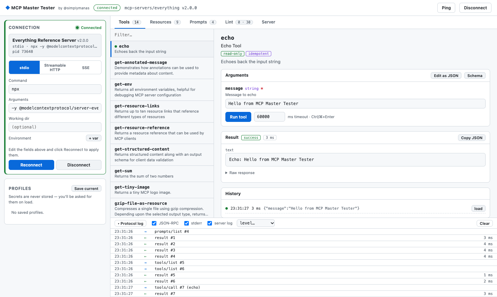
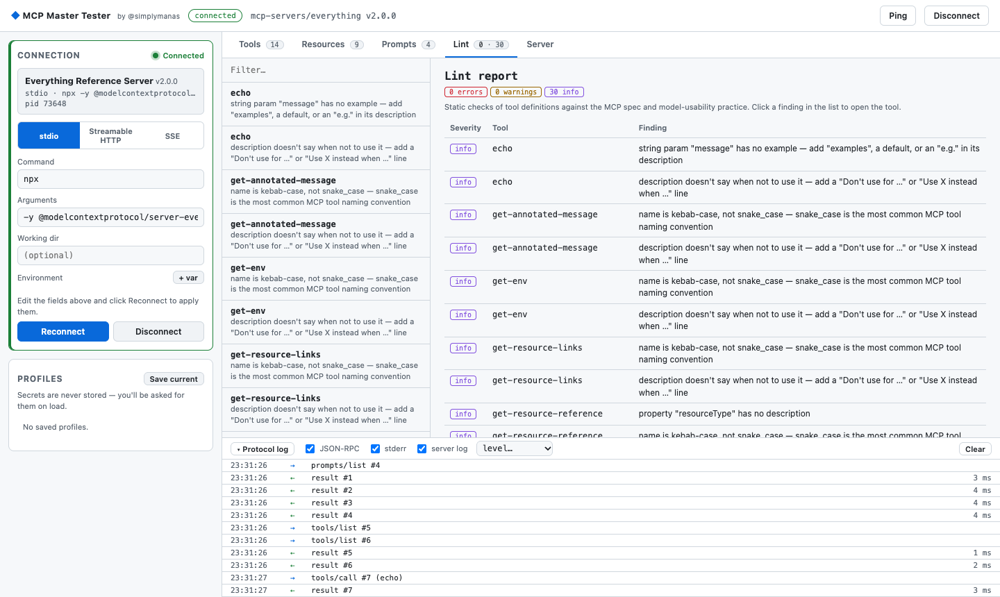
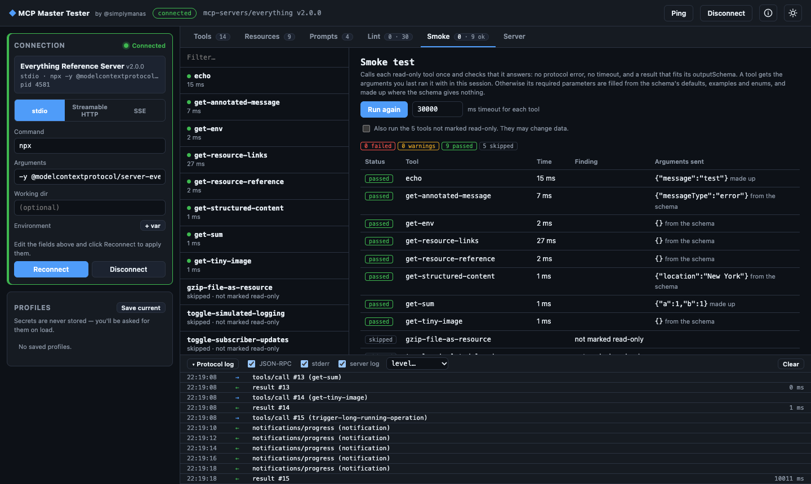

# MCP Master Tester

[](https://www.npmjs.com/package/mcp-master-tester)
[](https://github.com/simplymanas/mcp-master-tester/actions/workflows/ci.yml)
[](LICENSE)
[](https://nodejs.org)
[](CONTRIBUTING.md)
[](https://github.com/simplymanas/mcp-master-tester/stargazers)

**A local web UI to connect to, inspect and test any [Model Context Protocol](https://modelcontextprotocol.io) server.**

You point it at a server, either a local command over stdio or a remote URL over Streamable HTTP or SSE. It lists the server's tools, resources and prompts and gives each one a form, so you can call it and see exactly what comes back, down to every JSON-RPC message.

📖 **Tutorial:** [Testing any MCP server, step by step, with MCP Master Tester](https://medium.com/simplymanas/testing-any-mcp-server-step-by-step-with-mcp-master-tester-5b5cf4c0cc35) on Medium.

🔒 **1.2.1 is a security fix:** a server could run script in the tester's page through a tool schema. Please update; `npx mcp-master-tester@latest` gets it. Details are in the [CHANGELOG](CHANGELOG.md#121---2026-11-12).

🆕 **What's new in 1.3:** a smoke test. One click in the new **Smoke** tab, or `npx mcp-master-tester smoke -- <server command>` in CI, calls every read-only tool once and tells you which ones don't answer properly (see [Smoke test in CI](#smoke-test-in-ci)). 1.2 added [lint in CI](#lint-in-ci) and a light/dark theme button. See the [CHANGELOG](CHANGELOG.md) or the [releases](https://github.com/simplymanas/mcp-master-tester/releases).

> 🤝 **Open source and looking for collaborators.** Whether you build MCP servers, love clean UIs, or just found a bug, see [Contributing](#contributing). First-time contributors are welcome.

```bash
npx mcp-master-tester
```



---

## Features

- **Every transport:** stdio, Streamable HTTP and SSE. The Node backend proxies all traffic, so remote servers don't hit browser CORS limits.
- **Connection panel:** shows whether you're connected:
  - Not connected, Connecting… or Connected
  - when connected: the server's name and version, the transport, the command or URL, and the pid
  - edit any field and click **Reconnect** to apply it
  - one connection attempt runs at a time
  - closing or reloading the tab ends the session and stops the server process
- **Keys and auth:**
  - Environment variables for stdio servers. Headers or a Bearer token for remote ones.
  - Keys named like `*KEY*`, `*TOKEN*`, `*SECRET*` or `*PASSWORD*` are hidden automatically.
  - If a remote server answers **401**, the app prompts for a token and retries.
  - If a stdio server crashes and its error output mentions a missing key, the app offers to add it as an env var and reconnect.
- **Tool forms from the schema:** each tool's `inputSchema` becomes a form, with fields for each type:
  - strings, numbers and integers
  - booleans
  - enums, including `oneOf` / `const` with titles
  - multi-select arrays
  - JSON editors for objects
  - required-field checks before anything is sent, plus an *Edit as JSON* mode
- **Running tools:** set a timeout per call. Progress shows live from `notifications/progress`. Tools marked destructive ask for confirmation, and each tool keeps a call history.
- **Result viewer:** shows the result in readable form:
  - text (JSON is pretty-printed), images, audio, resource links and embedded resources
  - `structuredContent`, with multi-line strings broken at each `\n` so text blocks stay readable, and a hint when it only wraps the text output in one string (as Python FastMCP does when a tool returns a `str`)
  - an `isError` tool result shown separately from a protocol error
  - how long the call took
- **Resources:** static resources and URI templates (fill in the variables, then read). Both text and blob contents display.
- **Prompts:** fill in the arguments and see the messages the prompt returns.
- **Elicitation:** if a server sends `elicitation/create` to ask the user for input, a form built from its `requestedSchema` appears. (URL-mode requests aren't supported yet; see [Limitations](#limitations).)
- **Lint:** checks each tool definition against the spec and against what models handle well:
  - **Spec:** `inputSchema` and `outputSchema` must be of type object, required fields must be defined, names must be valid and unique
  - **Confusable tools:** names that overlap so much a model may pick the wrong one (`get_user` vs `getUsers`), and near-identical descriptions
  - **Descriptions:** missing, very short, never saying when *not* to use the tool, or so long they eat context (it's sent with every request); also flags a whole tool list that is too big
  - **Parameters:**
    - missing types or descriptions
    - no `required` list when a parameter has no default
    - free-form strings that list fixed values (should be an enum)
    - strings that should be typed (booleans, numbers, dates, URLs, emails)
    - enums and strings that give no example
  - **Naming:** non-snake_case names, and names that break the server's own convention
  - **Annotations:** missing readOnly/destructive hints
  - **Output size:** list/search tools with no limit or pagination parameter
  - **From real calls:**
    - a badge and a warning when a result is over ~10k tokens
    - a badge and a warning when an `isError` result has no useful message for the model to recover from
  - **The tab count** shows errors + warnings, coloured by the worst one, followed by the info findings in muted text. For example, `2 · 14` means 2 errors or warnings and 14 info suggestions.
- **Smoke test:** the **Smoke** tab calls every read-only tool once and shows which ones pass:
  - it fails a tool that doesn't answer in time, crashes the server, throws a protocol error, or returns a result that breaks its `outputSchema`
  - arguments come from your last run of the tool in this session, else from the schema's defaults, examples and enums, else they are made up (and an error for a made-up value is a warning, not a failure)
  - tools not marked read-only are left out unless you tick the box, and it asks before running them
  - click a result to open the tool with the arguments sent and the full result
  - the same test runs from the command line: see [Smoke test in CI](#smoke-test-in-ci)
- **Protocol log:** shows traffic and server output, newest at the bottom:
  - every JSON-RPC frame in both directions, with request → response time
  - the server's stderr
  - `notifications/message` log entries
  - a `logging/setLevel` control, available when the server declares the `logging` capability (otherwise it reads "no logging support")
- **Profiles:** saved in your browser. Secrets are never stored, so the app asks for them when you connect.
- **No build step:** Express on the backend and plain JavaScript in the browser. Light and dark themes follow your system setting, or pick one with the button at the top right; the choice is remembered. The ⓘ button next to it shows the version and project links, and the layout works on phone-sized screens.

## Lightweight

Staying small is a goal of this project, and the test suite enforces it.

| | MCP Master Tester 1.3.0 | MCP Inspector 2.15.0 |
|---|---|---|
| Runtime dependencies | 2 | 22 |
| Packages installed | 96 | 121 |
| Size on disk after install | 27 MB | 100 MB |
| The package itself, unpacked | 164 kB | 6.6 MB |

Measured on 2026-11-12 with `npm install <package>` in an empty folder on macOS. The two tools differ in scope, so this compares install weight only.

- **Two dependencies:** the official MCP SDK and Express. Nearly all of the 27 MB is the SDK's own dependency tree; this project's code is a 52 kB download.
- **No build step, no frontend framework, no install scripts.**
- **Nothing loads from the internet:** no CDN, fonts or analytics. The page's Content-Security-Policy blocks it.
- **A weight budget in the tests** (`test/package.test.js`): a pull request that adds a dependency or pushes the package past its size limit fails CI.

## Screenshots

**Running a tool:** the form built from the tool's schema, the result, call history and the live protocol log.



**Lint report:** each finding links to its tool.



**Smoke test:** every read-only tool called once, with the arguments that were sent.



## Quick start

```bash
npx mcp-master-tester
```

Or run from source:

```bash
git clone https://github.com/simplymanas/mcp-master-tester.git
cd mcp-master-tester
npm install
npm start
```

Open **http://127.0.0.1:6280** and click **Connect**. The default fields launch the reference server (`npx -y @modelcontextprotocol/server-everything`), which uses every feature above.

Requires **Node.js 20+**. To use a different port, set `PORT`, for example `PORT=7000 npx mcp-master-tester`. If the port is already taken, it says so and exits instead of starting.

## Lint in CI

The same lint rules run from the command line, so you can check your server's tool definitions on every commit. The command connects to the server, lists its tools, prints the findings and exits non-zero when there are any at your chosen level.

```bash
# stdio: put the server command after --
npx mcp-master-tester lint -- node dist/index.js

# Streamable HTTP (add --sse for the legacy SSE transport)
npx mcp-master-tester lint --url https://example.com/mcp --header "Authorization: Bearer $TOKEN"
```

```text
mcp-master-tester lint · my-server v1.4.0 · 12 tools · stdio

  error  send_mail    required "subject" is not defined in properties
  warn   get_user     name is very close to "getUsers" — models may confuse them; …
  warn   send_mail    missing description — models cannot tell when to use it

✖ failed: 1 error, 2 warnings, 9 info (add --show-info to list the info findings). Failing on: error.
```

| Option | What it does |
|---|---|
| `--fail-on <level>` | Exit 1 at `error` (default), `warn` or `info` findings, or `never` |
| `--format <format>` | `text` (default), `json`, or `github` for GitHub Actions annotations |
| `--show-info` | List info findings too (they're always counted) |
| `--env KEY=VALUE`, `--cwd <dir>` | Environment and working directory for a stdio server |
| `--url <url>`, `--sse`, `--header "Name: value"` | Connect to a remote server |
| `--timeout <ms>` | Give up after this long (default 30000) |

Exit codes: `0` passed, `1` findings at or above `--fail-on`, `2` the server couldn't be started or reached, or the options were wrong. If a stdio server crashes on start, its stderr is printed.

**GitHub Actions:**

```yaml
- run: npm ci && npm run build
- run: npx -y mcp-master-tester lint --format github --fail-on warn -- node dist/index.js
```

With `--format github`, each finding shows up as an annotation on the workflow run.

## Smoke test in CI

A smoke test answers a different question from lint: not "are the tool definitions good?" but "do the tools actually work?". The command calls each read-only tool once and fails if one doesn't answer properly.

```bash
npx mcp-master-tester smoke -- node dist/index.js
```

```text
mcp-master-tester smoke · my-server v1.4.0 · 6 tools · stdio

  pass  ping_db           2 ms
  pass  get_weather      48 ms
  warn  find_user         3 ms  returned an error for the made-up "id": No user with id "test". Ids look like "u_1".
  fail  get_report       12 ms  result breaks its outputSchema: … data/celsius must be number
  fail  slow_query    30001 ms  no answer: timed out after 30001 ms
  skip  delete_user             not marked read-only

✖ failed: 2 failed, 1 warning, 2 passed, 1 skipped. Failing on: fail.
```

**What runs.** Only tools marked read-only (`annotations.readOnlyHint: true`), so nothing is changed on the server. Add `--all` to run the others too, or name tools with `--tool`. If no tool runs at all, the command fails, because a run that called nothing has proved nothing.

**What is sent.** A value for each required parameter and nothing else:

1. the schema's `default`, first `examples` entry, `const` or first `enum` value, if it has one
2. otherwise a made-up placeholder: `"test"`, `1`, or a value that fits the `format` (a URL, an email address, a date)

**How an answer is judged:**

| Result | When |
|---|---|
| `pass` | The tool answered with a normal result. |
| `fail` | No answer before the timeout; the server closed the connection; a protocol error (the tool threw instead of returning an error result); a result that breaks the tool's `outputSchema`; or an error result for arguments that came from the schema or from you. |
| `warn` | An error result, or "invalid params", for made-up arguments: the tool answered, but a placeholder can't prove it works. Also a result over ~10k tokens. |
| `skip` | Not marked read-only, left out with `--skip`, or listed after a tool that crashed the server. |

**Give real arguments** to turn warnings into real checks. Print what would be sent, replace the made-up values, and pass the file back:

```bash
npx mcp-master-tester smoke --print-args -- node dist/index.js > smoke.json
# edit smoke.json, for example:  { "find_user": { "id": "u_1" } }
npx mcp-master-tester smoke --args smoke.json -- node dist/index.js
```

| Option | What it does |
|---|---|
| `--all` | Also run tools that aren't marked read-only. They may change data. |
| `--tool <name>` | Run only this tool (repeatable), read-only or not |
| `--skip <name>` | Leave this tool out (repeatable) |
| `--args <file>` | JSON file of arguments: `{ "tool_name": { "param": "value" } }` |
| `--print-args` | Print the arguments that would be sent, and run nothing |
| `--fail-on <level>` | Exit 1 on `fail` (default) or also on `warn`, or `never` |
| `--timeout <ms>` | How long each tool may take (default 30000) |

`--format`, `--env`, `--cwd`, `--url`, `--sse` and `--header` work as they do for `lint`, and so do the exit codes. A misspelt tool name in `--tool`, `--skip` or the `--args` file is an error (exit 2), so a renamed tool can't quietly drop out of the test.

**GitHub Actions**, next to lint:

```yaml
- run: npx -y mcp-master-tester lint --format github --fail-on warn -- node dist/index.js
- run: npx -y mcp-master-tester smoke --format github --args smoke.json -- node dist/index.js
```

## Connecting to servers

| Server type | Settings |
|---|---|
| Local npm package | stdio → Command `npx`, Arguments `-y @modelcontextprotocol/server-filesystem /path/to/dir` |
| Local script | stdio → Command `python`, Arguments `my_server.py`, Working dir as needed |
| Needs an API key | stdio → **+ var** → `GITHUB_PERSONAL_ACCESS_TOKEN` = `…` (hidden automatically) |
| Remote (current spec) | Streamable HTTP → URL `https://host/mcp`, plus a Bearer token if required |
| Remote (legacy) | SSE → URL `https://host/sse` |

Shortcut: <kbd>Ctrl</kbd>/<kbd>⌘</kbd> + <kbd>Enter</kbd> runs the selected tool, prompt or resource.

## How it works

```
Browser UI ──REST──▶ Express backend ──MCP──▶ your server (stdio | Streamable HTTP | SSE)
           ◀──SSE───  (one MCP Client per session; streams RPC frames, stderr, logs, elicitations)
```

| File | Responsibility |
|---|---|
| `cli.js` | Command-line entry point: starts the web UI, or runs `lint` or `smoke` for CI |
| `server.js` | Session lifecycle, transports, JSON-RPC tap, elicitation bridge, REST API |
| `public/app.js` | Connection form, schema forms, result rendering, protocol log |
| `public/theme.js` | Light/dark theme toggle (loaded in `<head>` so there's no flash of the wrong theme) |
| `public/forms.js` | Argument forms built from a JSON Schema (pure functions that escape everything the server sends) |
| `public/lint.js` | Lint rules (pure functions, shared by the UI, the CLI and the unit tests) |
| `public/smoke.js` | Smoke test: which tools run, which arguments are sent, how answers are judged (pure functions, shared the same way) |
| `public/style.css` | Theme tokens (light/dark) and layout |
| `public/index.html` | Page shell |
| `test/api.test.js` | Integration tests against the reference server (`npm test`) |
| `test/lint.test.js` | Unit tests for every lint rule (`npm test`) |
| `test/smoke.test.js` | Unit tests for the smoke test's planning and judging |
| `test/forms.test.js` | Unit tests that hostile schema text never becomes markup in a form |
| `test/package.test.js` | Weight budget: dependency list, package size and published files |
| `test/cli.test.js` | Tests for `lint` and `smoke` from the command line, using fixture servers in `test/fixtures/` |

### REST API

All calls are `POST` with a JSON body. The reply is `{ ok, ms, result }`, or on failure `{ ok: false, error, code, data, authRequired }`.

| Endpoint | MCP method |
|---|---|
| `/api/sessions` | connect (`initialize`) |
| `DELETE /api/sessions/:id` | close |
| `GET /api/sessions/:id/events` | event stream (SSE) |
| `/api/sessions/:id/ping` | `ping` |
| `/api/sessions/:id/tools/list` · `tools/call` | `tools/*` |
| `/api/sessions/:id/resources/list` · `resources/templates` · `resources/read` | `resources/*` |
| `/api/sessions/:id/prompts/list` · `prompts/get` | `prompts/*` |
| `/api/sessions/:id/logging/level` | `logging/setLevel` |
| `/api/sessions/:id/elicit/:reqId` | answer to `elicitation/create` |
| `GET /api/info` | none: returns `{ name, version }` of this app, unwrapped |

## Security

- The backend listens on **`127.0.0.1` only**, because it can run any command you enter in the stdio form. Don't expose it on a network.
- Requests with a `Host` header other than `127.0.0.1` or `localhost` are rejected, which blocks DNS-rebinding attacks from malicious websites.
- Requests with an `Origin` other than the app itself are rejected, so another website open in your browser can't call the backend.
- Everything a server sends (names, descriptions, schemas, results, logs) is treated as untrusted and escaped before display. A Content-Security-Policy backs that up: injected script and event handlers don't run, and the page can't load or send anything outside the app.
- Secrets stay in memory in the browser tab and backend process. Profiles save names only, never values.
- Closing or reloading the tab ends the session, so stdio server processes don't keep running in the background.
- Tools are only run when you click Run. Tools marked destructive ask for confirmation first.

## Limitations

- No browser login (OAuth) flow for remote servers. Use a Bearer token or custom headers instead.
- Sampling (`sampling/createMessage`) and roots are not advertised to servers.
- URL-mode elicitation is not advertised to servers, so they can only ask for input with a form.

## Contributing

This project is better with more people testing more MCP servers. All contributions are welcome, from typo fixes to new features.

### Ways to help

- **Try it on your MCP server** and [open an issue](https://github.com/simplymanas/mcp-master-tester/issues) for anything that breaks or looks wrong. Real-world servers are the best test suite.
- **Pick up a roadmap item** below. Comment on its issue first (or open one) so we don't duplicate work.
- **Improve the lint rules:** suggest checks that catch tool definitions models struggle with. The rules live in [`public/lint.js`](public/lint.js), each with a case it must flag and a near-miss it must not flag in [`test/lint.test.js`](test/lint.test.js). Open an issue with the idea, or a PR with the rule and its tests.
- **Improve the docs:** add examples of configs for popular servers, write guides, or add screenshots.
- **Share it** with people building on MCP. ⭐ Stars help others find the project.

### Roadmap: help wanted

| Item | Difficulty |
|---|---|
| OAuth 2.1 sign-in for remote servers | Hard |
| Sampling (`sampling/createMessage`) with a manual or LLM-backed responder | Medium |
| Roots support | Easy |
| URL-mode elicitation: advertise it and show the link (http and https only) | Easy |
| When `structuredContent` breaks its `outputSchema`, show the result next to the validation errors | Easy |
| Smoke test: resources and prompts too, and several argument sets per tool | Medium |
| Export and import a session (calls and results) as JSON | Easy |
| Resource subscriptions (`resources/subscribe`) with live updates | Medium |
| Docker image | Easy |

### How to contribute

Read **[CONTRIBUTING.md](CONTRIBUTING.md)** for setup, the project layout, running tests and the guidelines. In short: fork the repo, create a branch, make your change, run `npm test`, and open a pull request.

Not sure where to start? Open an issue with your idea or question. Happy to help you get your first pull request merged.

Please follow the [Code of Conduct](CODE_OF_CONDUCT.md). To report a security issue, see [SECURITY.md](SECURITY.md).

## Changelog

Release notes for every version are in [CHANGELOG.md](CHANGELOG.md).

## License

MIT

---

Author: **@simplymanas**
